# Unbound

Plan a trip or move abroad with an AI assistant, then follow it step by step: the documents you need, what it costs, every step with its deadline, and what Unbound can do for you (prefill application forms from your documents and download them as filled-in official PDFs, pay fees, calendar reminders, document requests). Immigration rules come from official government pages, re-checked every day.

**Explore** shows a 3D globe of where your passport lets you go (verified guidelines first, an open
visa dataset as an indicative fallback, always labelled with its source). The app is in English,
Hungarian and Russian.

```
frontend/   React + Vite + Tailwind (served by nginx in production)
backend/    FastAPI API, AI agents, guidelines pipeline, worker
deploy/     Caddyfile (HTTPS) for production
```

**Contents:** [Architecture](#architecture) · [Core principle](#core-principle-the-model-talks-code-decides) ·
[Chat agent](#chat-agent) · [Journeys](#journeys) · [Documents](#document-analysis) ·
[Guidelines pipeline](#guidelines-pipeline) · [Explore](#explore-map) · [Data model](#data-model) ·
[Run locally](#run-locally) · [Deploy](#deploy-one-server)

---

## Architecture

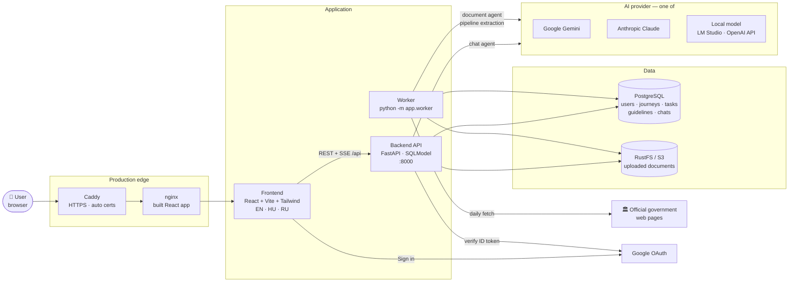

| Service | Role |
| --- | --- |
| **Frontend** | SPA: landing, wizard, assistant chat, journeys, documents, to-do, finances, forms, explore globe, admin data sources |
| **Backend API** | Auth (Google → JWT), REST resources, chat streamed over Server-Sent Events |
| **Worker** | Document analysis queue + daily guidelines pipeline (one at a time via a Postgres advisory lock) |
| **PostgreSQL** | All application state, including the verified country guidelines |
| **RustFS** | S3-compatible storage for uploaded passports, certificates, etc. |
| **AI provider** | Picked with `LLM_PROVIDER` (`gemini`, `anthropic`, `local`); everything above it is provider-independent |

### Backend modules

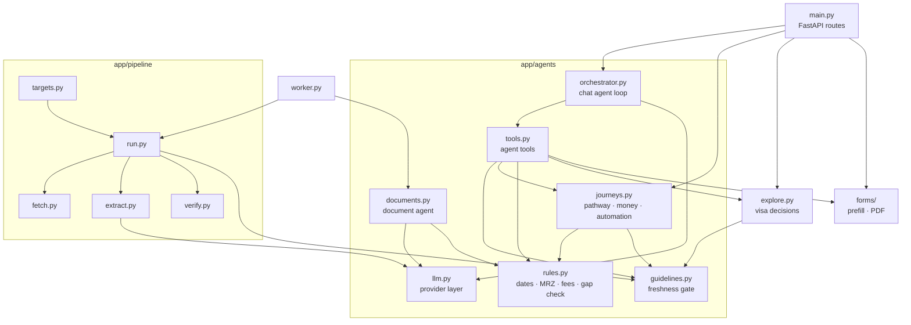

---

## Core principle: the model talks, code decides

The language model never decides anything with legal or numeric weight. It converses, picks tools
and reads documents into raw strings; deterministic code does the rest.

```mermaid
flowchart LR
    subgraph model["🤖 Model decides"]
        m1["What to say"]
        m2["Which tool to call"]
        m3["Raw text read from a document"]
        m4["Facts proposed from official pages<br/>with a quote as evidence"]
    end
    subgraph code["⚙️ Code decides"]
        c1["Whether a guideline may be used<br/>freshness gate"]
        c2["Date parsing — ambiguous dates are reported, never guessed"]
        c3["Passport MRZ check digits"]
        c4["Document validity windows, minimum amounts"]
        c5["Fee totals in Decimal, per currency"]
        c6["Requirement gap: satisfied · problem · missing"]
        c7["Step due dates, form filling"]
        c8["Keeping a pipeline fact only if its quote<br/>and numbers are on the page"]
    end
    model -. "proposals only" .-> code
```

### Guideline freshness gate

Every immigration fact the assistant uses passes through `guidelines.find()`:

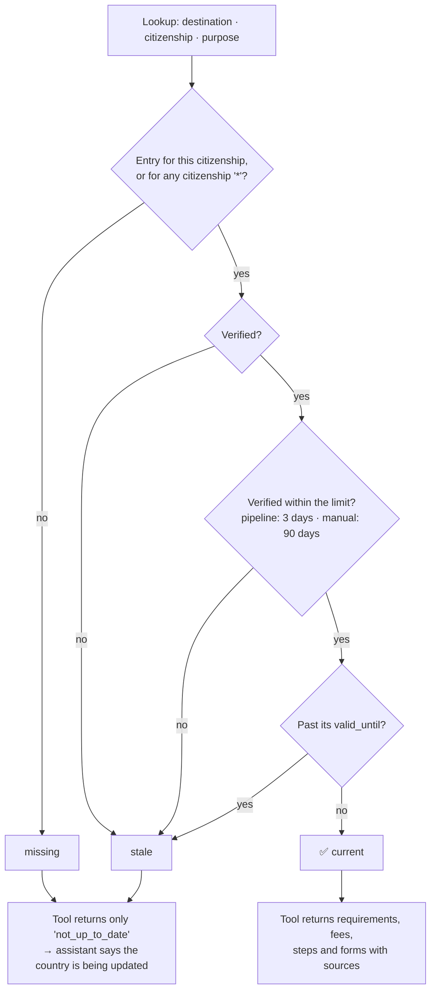

---

## Chat agent

`POST /api/chat/sessions/{id}/messages` streams the turn as Server-Sent Events: assistant text,
tool progress (`start` / `done` / `error`) and finally which data changed, so the UI refreshes
journeys, to-dos or forms without reloading.

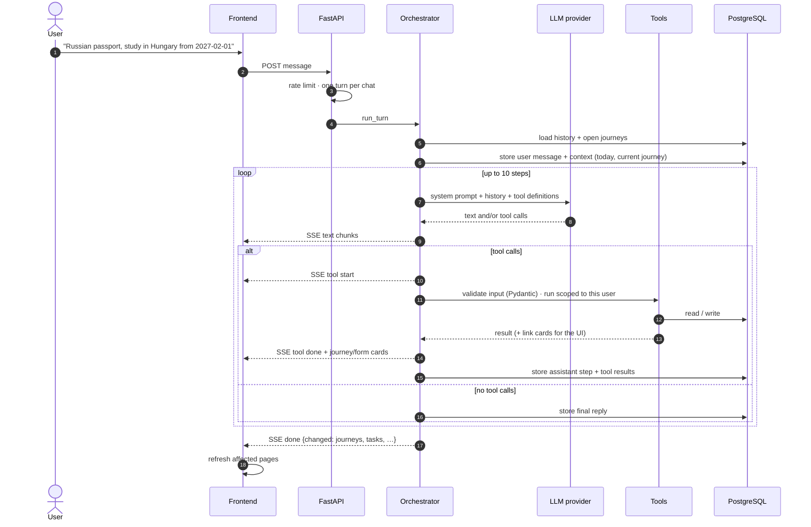

### Agent tools

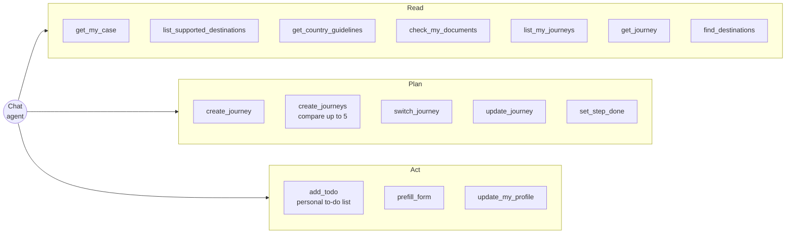

| Tool | What it does |
| --- | --- |
| `get_my_case` | Profile, analysed documents, journeys with progress, personal to-dos |
| `get_country_guidelines` | Verified requirements, fees, steps and forms (only when current) |
| `check_my_documents` | Gap check of the user's documents against a trip's requirements |
| `create_journey` / `create_journeys` | Build one journey, or several to compare side by side |
| `switch_journey` / `get_journey` / `list_my_journeys` | Move between and inspect the user's journeys |
| `update_journey` | Status, travel date, stay length (due dates are recomputed), summary |
| `set_step_done` | Tick a pathway step |
| `add_todo` | Add an item to the personal to-do list, optionally with a due date |
| `prefill_form` | Fill an application form from passport, profile and journey |
| `find_destinations` | Easiest destinations for the passport, or alternatives near a hard one |
| `update_my_profile` | Save citizenship, address, status, studies |

### LLM provider layer

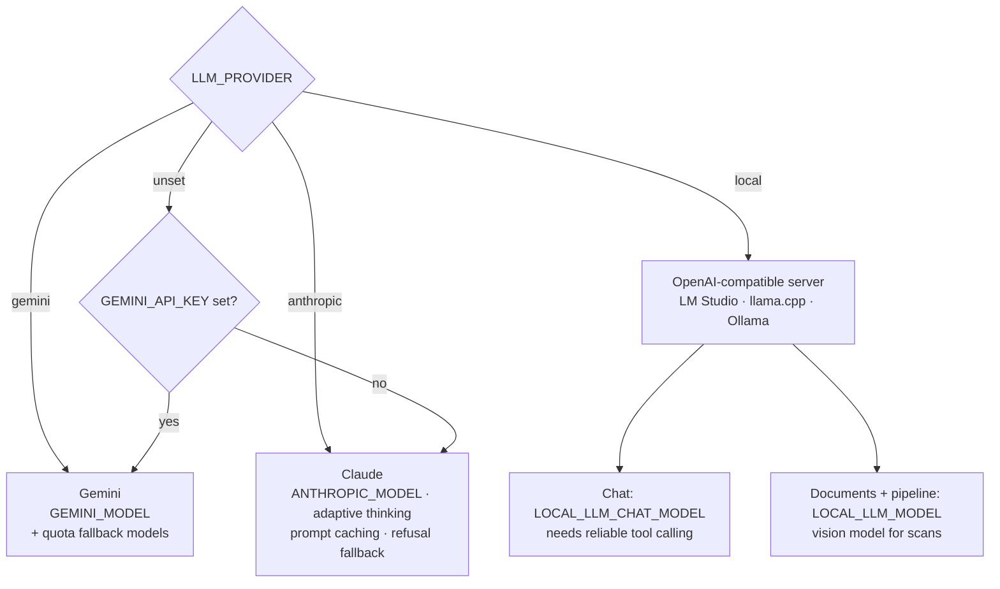

---

## Journeys

A journey is the user's plan for one trip or move. It is created from a **current** guideline and
stores a pathway of tasks; everything else is computed live by `journeys.view()` on every read, so
the chat and the UI always agree.

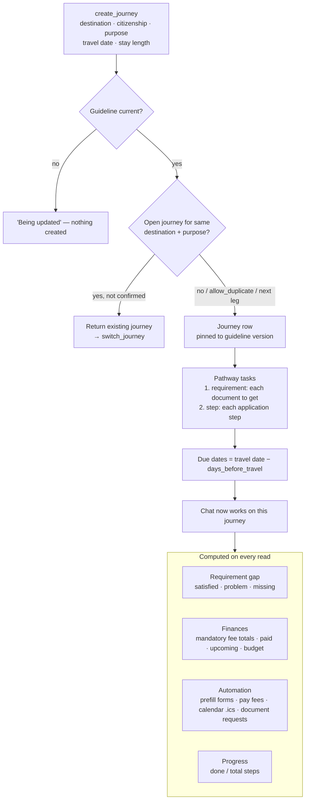

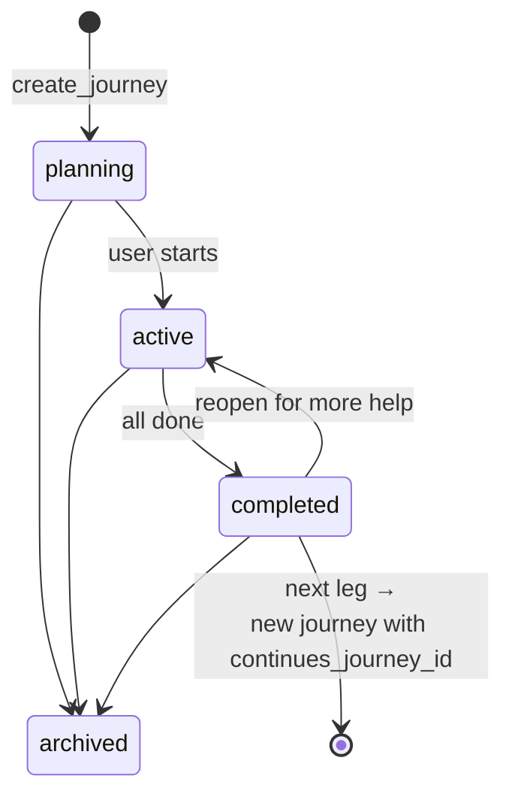

### To-do list

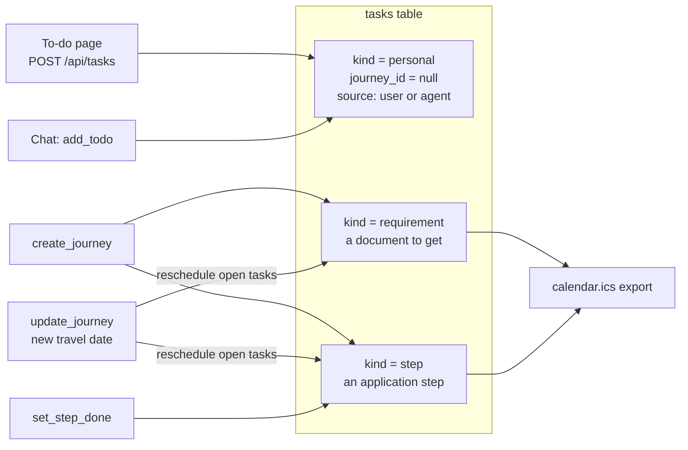

---

## Document analysis

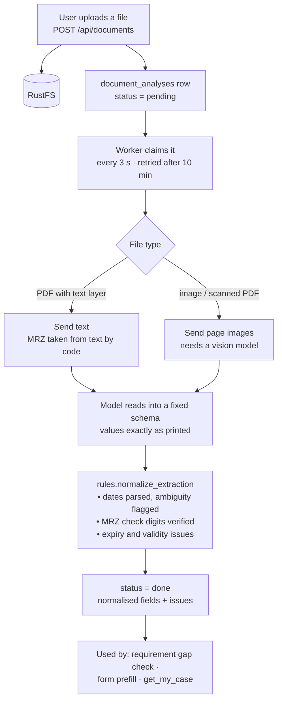

---

## Guidelines pipeline

Runs daily at `PIPELINE_HOUR_UTC` (and on demand from the admin **Data sources** page). Each target
is one `(destination, citizenship, purpose)` with seed URLs on allowlisted official domains.

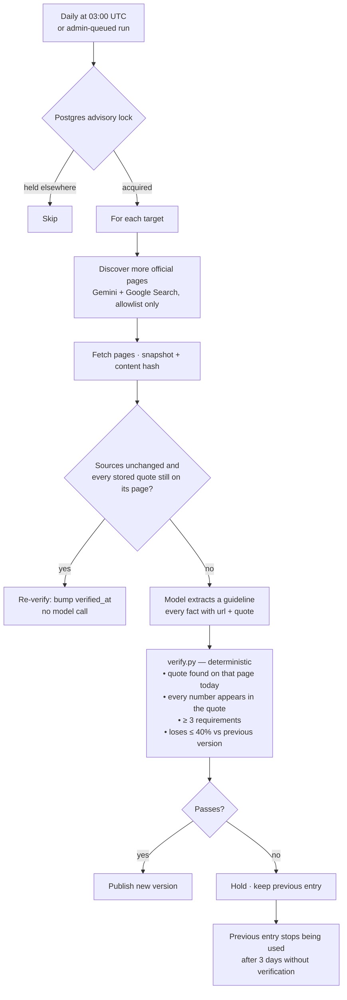

---

## Explore map

`explore.py` decides each destination's status for one passport, residence permit and purpose,
and records which source decided it — strongest first:

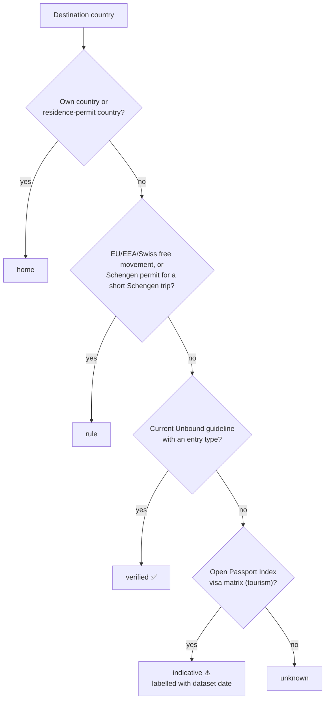

The map ranks visa-free first, then visa on arrival, then eVisa, and suggests easier alternatives
near a country that is hard to enter. The chat uses the same logic via `find_destinations`.

---

## Data model

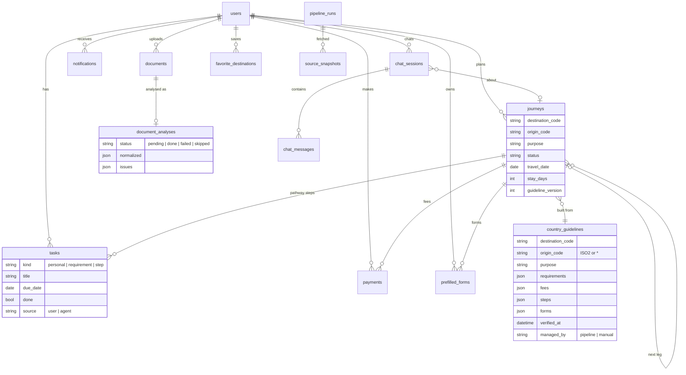

---

## Run locally

Requirements: Docker (Compose v2) and Node.js 22+ (`nvm use` reads `.nvmrc`).

```bash
npm run setup     # creates .env from .env.example, generates JWT_SECRET, installs frontend deps
```

Then fill in `.env`: `GOOGLE_CLIENT_ID` (OAuth "Web application" client, authorised origin
`http://localhost:5173`) and an AI provider (`GEMINI_API_KEY`, `ANTHROPIC_API_KEY`, or a local model:
see [backend/README.md](backend/README.md)). `.env` is the only env file you edit: compose passes it
to the containers and `frontend/vite.config.ts` reads `GOOGLE_CLIENT_ID` from it.

```bash
npm run dev         # Postgres, storage, API on :8000 and worker in Docker; frontend locally on :5173
npm run docker:up   # or everything in Docker, frontend included (hot reload)
```

The app must be on port 5173 (the origin the API allows), so don't run both at once. After changing
`.env`, run the command again to recreate the containers. Add your Google account to `ADMIN_EMAILS`
in `.env` to see **Data sources** (the pipeline) in the app.

**Local model (LM Studio):** set `LLM_PROVIDER=local`, load the models, and start the server where
the containers can reach it: `~/.lmstudio/bin/lms server start --port 1234 --bind 172.17.0.1`. Use a
model with reliable tool calling for chat (`LOCAL_LLM_CHAT_MODEL`, e.g. `qwen3-4b-instruct-2507`) and
a vision model for scanned documents (`LOCAL_LLM_MODEL`, e.g. `qwen2.5-vl-7b-instruct`).

| Service | URL |
| --- | --- |
| App | http://localhost:5173 |
| API / docs | http://localhost:8000 · http://localhost:8000/docs |
| RustFS console | http://localhost:9001 (`minioadmin` / `minioadmin`) |
| Postgres | `localhost:5432`, `unbound_user` / `unbound_password`, db `unbound_db` |

| Command | What it does |
| --- | --- |
| `npm run setup` | Create `.env`, install frontend deps |
| `npm run dev` | Backend stack in Docker + local Vite dev server |
| `npm run docker:up` / `docker:down` | Start / stop everything |
| `npm run docker:reset` | Stop and **delete** the database and storage volumes |
| `npm run docker:logs` | Follow backend and worker logs |
| `npm test` | Backend tests (pytest, in the running backend container) |
| `npm run lint` / `npm run build` | Frontend lint / production build |
| `npm run check` | Lint, build and test |
| `npm run guidelines:import` | Load `backend/data/guidelines/` into the database |
| `npm run models:list` | Gemini models your key can use |

## Run the production stack locally

The same images and setup as production (built frontend behind nginx, backend without reload,
worker with the daily pipeline), on `http://localhost:8080`, without a domain or HTTPS:

```bash
./scripts/local-prod.sh up       # first run generates .env.prod.local with local-only secrets
./scripts/local-prod.sh logs     # backend + worker logs
./scripts/local-prod.sh down     # stop, keep data
./scripts/local-prod.sh reset    # stop and delete its data
```

It uses your `.env` keys but its own database and storage (project `unbound-local`), so it can run
next to the dev stack. Add `http://localhost:8080` to the Google OAuth client's authorised
JavaScript origins. Set `LOCAL_PORT` to use another port, and `PIPELINE_ENABLED=false` in `.env` to
keep it from spending AI quota on the daily pipeline.

## Deploy (one server)

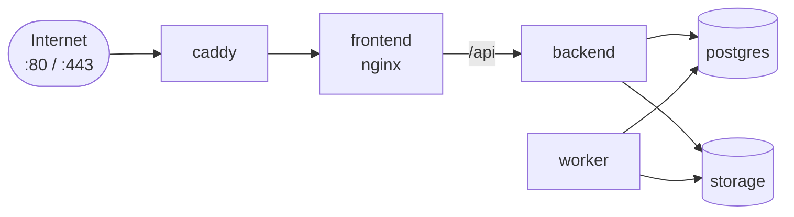

1. Point a domain at the server. In the Google OAuth client, add `https://<domain>` as an authorised JavaScript origin.
2. Fill the production part of `.env` (`DOMAIN`, `POSTGRES_PASSWORD`, `S3_ACCESS_KEY`, `S3_SECRET_KEY`) plus the keys above.
3. `docker compose -f docker-compose.prod.yml up -d --build`

Caddy gets HTTPS certificates automatically; only ports 80 and 443 are exposed. The worker runs the guidelines pipeline daily at `PIPELINE_HOUR_UTC` (default 03:00 UTC).

**AI quota:** a daily pipeline run plus chat needs a paid Gemini key (the free tier allows about 20 requests per model per day), an Anthropic key with credits, or a local model in LM Studio (`LLM_PROVIDER=local`, see [backend/README.md](backend/README.md)).

## Tests

```bash
npm test          # or: docker exec -w /app unbound_backend python -m pytest -q tests/
```

More detail: [backend/README.md](backend/README.md), [frontend/README.md](frontend/README.md).
